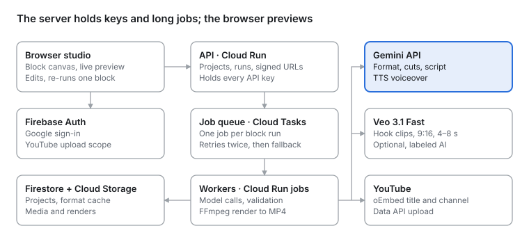
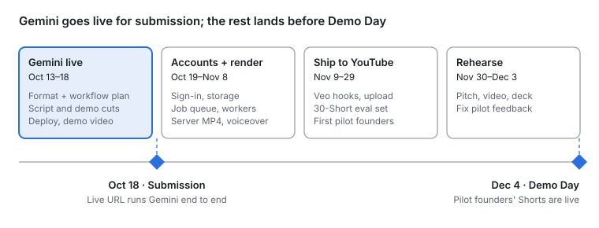

# PromoFlow — PRD (real version)

Oct 12, 2026 · Henry · brolab

## Overview

The real version replaces every mock in the prototype with Gemini, Veo and server rendering, so a founder can turn a public YouTube Short into a Short for their own app in under 5 minutes.

- **Problem:** app founders know Shorts sell, but hiring a UGC creator costs about $180 a video, and copying a viral Short by eye misses the structure that made it work.
- **Product:** paste a Short that works → Gemini extracts its format (beats, timing, captions, CTA) → PromoFlow recommends the workflow and a shot list that format needs → it rebuilds the Short from the founder's own screen recording, screenshots and face clip.
- **User:** solo founders and small teams shipping apps or SaaS. Their demo is a screen recording, not a product photo.
- **Goal by Oct 18 (submission):** Gemini runs the format, script and demo cuts on the live URL.
- **Goal by Dec 4 (Demo Day):** accounts, server render, voiceover, Veo hooks and direct YouTube upload; real pilot founders publishing Shorts.
- **Non-goals:** long-form editing, AI avatars as the main product, TikTok and Instagram publishing (later).

## Scope

One flow, end to end, with every step editable before the render.

1. **Sign in** with Google (also grants YouTube upload later).
2. **Paste a public Shorts link** → title, channel and thumbnail appear.
3. **Extract the format** → Gemini returns beats, durations, hook formula, caption style and CTA placement; cached per video ID.
4. **Get the recommended workflow** → PromoFlow builds only the blocks this format needs and wires them (no Proof block if the Short shows no results; a face-clip block if the creator speaks), plus a shot list per beat: what to record, what to say, which screen to show. The user accepts or edits it.
5. **Add the product by following the shot list:** context fields, 2–6 screenshots, one screen recording (≤ 3 min) with one action per step, the face-clip lines.
6. **Run** → script → hook clip → demo cuts → voiceover → proof → composed timeline. Each block shows its output as it finishes.
7. **Review** → edit any line, drag any cut, re-run one block without re-running the rest.
8. **Ship** → export a 1080 × 1920 MP4, or upload to YouTube as a Short with title, description and hashtags.

**Out of scope for Dec 4:** team workspaces, brand kits, multi-language voiceover, TikTok and Instagram publishing, analytics beyond YouTube views.

## Functional requirements

The block graph and typed wires stay as in the prototype; what changes is what runs inside each block.

| Block | Real behavior | Done when |
| --- | --- | --- |
| Reference Short | Parse any Shorts/watch/youtu.be link; oEmbed title and channel | Private or invalid link shows a clear error in < 2 s |
| Format extractor | Gemini watches the Short from its URL; returns the format JSON; cached by video ID | Beat boundaries within ±0.5 s on ≥ 80% of the eval set |
| Workflow planner (new) | Maps each beat to the block that fills it and wires the graph; Gemini writes a shot list per beat from the product context | Every beat has a source block, no unused block; shot list shown before any upload |
| Product context | Name, description, audience, pain, result, features; optional “import from my website” | All fields feed the planner and script prompts |
| Screenshots, demo | Resumable upload to Cloud Storage; demo MP4/MOV/WebM ≤ 3 min, ≤ 500 MB | Upload survives a page reload |
| Script writer | Gemini writes one line per beat in the format's tone; uses only facts from context | Every step line ≤ 8 words; no claim absent from context |
| Hook clip | Upload a face clip recorded from the shot list, or generate with Veo 3.1 Fast (9:16, 4–8 s) | Veo clip ready in ≤ 3 min and labeled AI-generated |
| Demo cutter | Gemini finds the start and end of each step in the recording; user can drag to adjust | ≥ 80% of cuts judged correct by a person |
| Voiceover (new) | Gemini TTS reads the script, timed to beats | Speech fits each beat within ±0.3 s |
| Proof collage | Grid from screenshots; optional real metrics typed by the user | Nothing invented on screen |
| Reel composer | Beat-ordered timeline, caption styles, Shorts safe zones, music bed | Browser preview matches the server MP4 |
| Publish | Gemini writes title, description, #shorts tags; YouTube Data API upload via OAuth | Video appears on the channel as a Short |

## AI implementation

Six model calls make one Short. All return JSON checked against a schema, retry once, then fall back to the labeled mock so a run never breaks.

| Step | Model | Input → output | Est. cost |
| --- | --- | --- | --- |
| Format | Gemini 3.8 Flash | YouTube URL → format JSON (beats, tone, captions, CTA) | \~$0.01 |
| Workflow + shot list | Gemini 3.8 Flash | Format + product context → block list and per-beat shot list (record, say, show) | < $0.01 |
| Demo cuts | Gemini 3.8 Flash | Uploaded recording (Files API) + step list → `[{step, start, end}]` | \~$0.01 per min |
| Script + metadata | Gemini 3.8 Flash | Format + product context → lines per beat, title, description, tags | < $0.01 |
| Voiceover | Gemini TTS | Script lines → audio per beat | \[verify price\] |
| Hook clip (optional) | Veo 3.1 Fast | Prompt + optional first frame → 4 s 9:16 clip | $0.40 |

The block graph itself comes from a fixed beat → block mapping, so it is deterministic; Gemini only writes the shot list.

**Guardrails**

- Facts only from the product context; the prompt forbids invented metrics, users or quotes.
- Never reuse the reference's wording: reject a script line that shares 5+ consecutive words with the reference captions.
- Veo hooks are labeled AI-generated in the app and flagged as synthetic content on upload.

**Evaluation**

- Hand-annotate 30 app and SaaS Shorts (beats, times, kinds). Track beat-boundary error and beat-kind accuracy for every prompt change.
- Score demo cuts and scripts by two reviewers on 20 runs; ship a prompt only if it beats the last one.

Prices: Gemini 3.8 Flash at $0.75 / $3.75 per 1M input/output tokens until Dec 31, 2026, about 100 tokens per second of video ([pricing](https://ai.google.dev/gemini-api/docs/pricing), [video docs](https://ai.google.dev/gemini-api/docs/video-understanding)).

## Architecture and data

| Browser / data | Cloud Run | Google AI & YouTube |
| --- | --- | --- |
| **Browser studio**: block canvas, live preview; edits, re-runs one block | **API · Cloud Run**: projects, runs, signed URLs; holds every API key | **Gemini API**: format, cuts, script; TTS voiceover |
| **Firebase Auth**: Google sign-in; YouTube upload scope | **Job queue · Cloud Tasks**: one job per block run; retries twice, then fallback | **Veo 3.1 Fast**: hook clips, 9:16, 4–8 s; optional, labeled AI |
| **Firestore + Cloud Storage**: projects, format cache; media and renders | **Workers · Cloud Run jobs**: model calls, validation; FFmpeg render to MP4 | **YouTube**: oEmbed title and channel; Data API upload |

The studio stays in the browser for editing and preview; everything slow or secret runs on Cloud Run behind a job queue.

- **Stack:** keep today's vanilla-JS studio; Node API on Cloud Run; Firestore; Cloud Storage with signed-URL uploads; Firebase Auth.
- **Runs:** each block run is one Cloud Tasks job; its output lands in Firestore and the studio shows it as it arrives.
- **Render:** canvas preview in the browser; an FFmpeg worker renders the final 1080 × 1920 MP4 from the same timeline JSON.
- **Data:** Project (blocks, wires) · Format (videoId, JSON, model, date; cached) · Asset (owner, path, kind) · Run (block, status, output, cost).

## Non-functional requirements

| Area | Requirement |
| --- | --- |
| Cost | ≤ $0.10 per Short without Veo, ≤ $0.60 with a Veo hook |
| Latency | Format ≤ 60 s; full run ≤ 3 min excluding Veo; preview starts ≤ 2 s after compose |
| Reliability | Every AI step has a labeled fallback; jobs retry twice; a failed block never blocks the rest |
| Limits | Gemini's YouTube input is in preview and free-tier capped at 8 h of video a day → paid tier + format cache |
| Privacy | Media is private to its owner, deleted on request and after 90 days of inactivity |
| Copyright | Only the structure of a reference is used; its video is never downloaded, stored or shown in output |
| AI disclosure | Veo clips are labeled in the app and flagged as altered or synthetic content on YouTube upload |
| Browsers | Studio works in current Chrome, Edge and Safari; final MP4 renders on the server |

## Metrics

Targets for Dec 4 are proposals to agree on before the first sprint.

| Metric | Target by Dec 4 |
| --- | --- |
| Time from sign-in to first exported Short | ≤ 5 min |
| New users who export a Short in their first session | ≥ 40% |
| Format beat boundaries within ±0.5 s (eval set) | ≥ 80% |
| Demo cuts judged correct | ≥ 80% |
| Runs that finish without a fallback | ≥ 95% |
| Model cost per Short, no Veo | ≤ $0.10 |
| Pilot founders who published a Short | \[N\] |
| Shorts published through PromoFlow, views tracked | ≥ 30 |

## Milestones, risks and open questions

| Phase | Dates | Work |
| --- | --- | --- |
| **Gemini live** | Oct 13–18 | Format + workflow plan · Script and demo cuts · Deploy, demo video |
| ◆ **Gate: Oct 18 · Submission** | | Live URL runs Gemini end to end |
| **Accounts + render** | Oct 19–Nov 8 | Sign-in, storage · Job queue, workers · Server MP4, voiceover |
| **Ship to YouTube** | Nov 9–29 | Veo hooks, upload · 30-Short eval set · First pilot founders |
| **Rehearse** | Nov 30–Dec 3 | Pitch, video, deck · Fix pilot feedback |
| ◆ **Gate: Dec 4 · Demo Day** | | Pilot founders' Shorts are live |

Only the Gemini sprint gates the submission; accounts, render and YouTube upload land before Demo Day.

**Risks**

- Gemini's YouTube input is a preview feature → cache formats, keep the hand-annotated fallback, test the paid tier early.
- Cuts on dense desktop recordings miss the action → users can drag cuts; add auto-zoom on clicks if time allows.
- Veo is slow and costs $0.40 a hook → optional, runs in the background; the founder's own clip is the default.
- Scope vs a small team → Sprint 3 items are cut first; upload and voiceover outrank Veo.

**Open questions**

- [ ] Who owns frontend, backend and AI evaluation?
- [ ] Gemini API or Vertex AI, given the Google Cloud prize?
- [ ] Caption and voiceover languages at launch: English only, or Vietnamese too?
- [ ] Pricing to test with pilots: $19 / $49 a month, or per Short?
